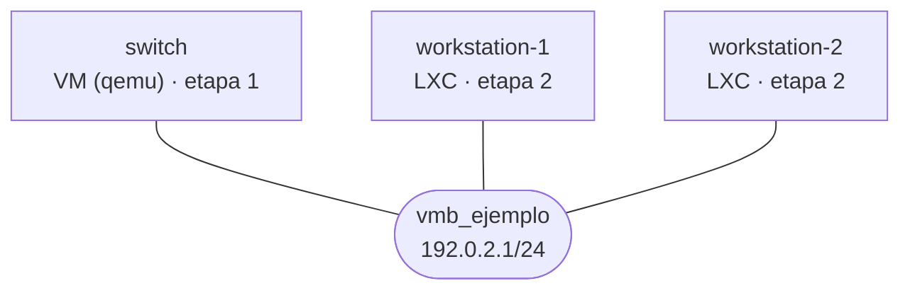

<!-- PROPÓSITO:   el documento del lab `01_ejemplo-topologia`. Dos regiones: la
     generada (datos derivados de la declaración) y la prosa (lo que el YAML no
     puede decir).
     INVARIANTES: dentro de los marcadores no se escribe a mano; `./lab check docs`
     falla si difiere del render. Fuera, ningún check opina.
     LÍMITES:     la prosa no repite valores que ya están en la tabla: los cita.
     VER:         AGENTS.md §Documentación; README.md §Documentación -->
# 01_ejemplo-topologia

La topología que pidió el encargo: **una VM que hace de conmutador y dos
contenedores que hacen de puestos de trabajo**. Es el lab "grande" de los dos de
ejemplo, y el único que ejercita las dos ramas del motor (QEMU y LXC).

Sirve para leer el motor de una vez: aquí se ve un lab que declara dos etapas de
arranque, un bridge propio, una VM con rol `switch` y dos contenedores que comparten
etapa —sin vmid, sin MAC y sin ningún nombre de invitado escrito a mano—.

<!-- generado:inicio -->
_Datos derivados de `01_ejemplo-topologia.yml`. Los reescribe `./lab check docs --actualizar`;
si los editas a mano, `./lab check docs` falla._

## Topología



## Invitados declarados

| rol | tipo | stage | cores | memory (MB) | disk (GB) | bridge | address |
| --- | --- | --- | --- | --- | --- | --- | --- |
| switch | VM (qemu) | 1 | 2 | 512 | 8 | vmb_ejemplo | 192.0.2.2/24 |
| workstation-1 | LXC | 2 | 1 | 256 | 4 | vmb_ejemplo | 192.0.2.11/24 |
| workstation-2 | LXC | 2 | 1 | 256 | 4 | vmb_ejemplo | 192.0.2.12/24 |

## Bridges del lab

| bridge | dirección del bridge |
| --- | --- |
| vmb_ejemplo | 192.0.2.1/24 |

## Orden de arranque (etapas)

| stage | roles |
| --- | --- |
| 1 | switch |
| 2 | workstation-1, workstation-2 |

## Identidad: la deriva el motor, no la declara el lab

| rol | tipo | nombre canónico | vmid | MAC |
| --- | --- | --- | --- | --- |
| switch | VM (qemu) | {equipo}-{alias} | — | — |
| workstation-1 | LXC | {equipo}-{alias} | — | — |
| workstation-2 | LXC | {equipo}-{alias} | — | — |

El **vmid** (el menor libre de *todo* el clúster) y la **MAC** (`BC:24:11` + los
bytes del vmid) los asigna `apply` leyendo el estado de Proxmox: no se declaran aquí y
no se guardan en ningún fichero del repositorio. Por eso estas dos columnas son un
guion hasta que exista un despliegue real.

## Cómo se entra a cada equipo

| rol | tipo | usuario | credencial | forma de acceso |
| --- | --- | --- | --- | --- |
| switch | VM (qemu) | — | — | no se entra: no declara `config:` |
| workstation-1 | LXC | — | — | no se entra: no declara `config:` |
| workstation-2 | LXC | — | — | no se entra: no declara `config:` |

El **usuario**, la **credencial** (de dónde sale Y cuánto vale) y la **forma de acceso** se
derivan de la declaración, del motor y de `deployment_engine/secrets.yml`. **Este lab es de un
solo uso y la contraseña se escribe aquí a la vista a propósito** (decisión explícita del dueño
del repo): es un cuadro de acceso, no un secreto — en un lab efímero prima poder entrar. El
puerto sale del **vmid**, que no se conoce hasta `apply`: por eso va como fórmula (`base`+vmid)
y el número de verdad lo dice el despliegue. Un invitado sin `config:` no se toca, y su fila lo
dice en vez de fingir un acceso que no hay. (En un Linux la credencial **no es una contraseña**:
es el **fichero** de la clave del lab, y por eso se enseña su ruta, no un valor.)
<!-- generado:fin -->

## Cómo llevarlo a un Proxmox real

Los pasos exactos, en orden. Este repositorio **se ha ejecutado ya contra un
Proxmox real** siguiendo estos pasos; abajo quedan anotadas las dos trampas que
aparecieron (nombre del nodo y nombre del bridge).

1. **Rellena las credenciales** (no se versionan; se escriben a mano, ya no hay
   `.example` que copiar):
   ```
   $EDITOR deployment_engine/secrets.yml
   chmod 600 deployment_engine/secrets.yml
   ```
   Las claves y qué significa cada una están en el README, §«Las credenciales se
   escriben a mano». En corto: `pve_nodo` (el host de la API), `pve_nombre_nodo`
   (el nombre con el que Proxmox conoce al nodo, el de `/nodes/<nombre>/...`),
   `pve_puerto` (8006 por defecto), `pve_token_id` y `pve_token_secreto`.

   > Ejecutado contra un Proxmox real: si el nodo se llama `Proxmox` y se alcanza
   > por su IP, `pve_nodo` y `pve_nombre_nodo` son distintos. Poner el host en los
   > dos hace que la API conteste **596 "no such node"** al preguntar por la red.

2. **Sustituye las direcciones del lab.** Este lab declara direcciones en
   `192.0.2.0/24`, que es un rango reservado para documentación (RFC 5737) y no
   existe en ninguna red real. Edita `01_ejemplo-topologia.yml` y pon las tuyas. El
   nombre del bridge (`vmb_ejemplo`) ya cumple el formato que el núcleo exige
   (sin guiones, 2 a 15 caracteres): el motor rechaza los que no lo cumplen antes
   de tocar la API.

3. **Mira el plan** (no toca nada):
   ```
   ./lab --lab 01_ejemplo-topologia plan --api
   ```
   Sin `--api`, `plan` usa un clúster vacío simulado y sirve igual para revisar el
   orden de las llamadas.

4. **Pregunta qué hay y qué falta**, sólo lectura:
   ```
   ./lab --lab 01_ejemplo-topologia preflight
   ```

5. **Converge**:
   ```
   ./lab --lab 01_ejemplo-topologia apply
   ```
   `apply` ejecuta exactamente el plan que acabas de ver: crea el pool, crea el
   bridge si falta, crea o ajusta cada invitado y los arranca por etapas.

6. **Verifica** contra la API, que es el único test que no se cree a sí mismo:
   ```
   ./lab --lab 01_ejemplo-topologia verify
   ```

7. **Destruye** cuando ya no lo quieras (borra los invitados del lab y, al final,
   su pool si ha quedado vacío):
   ```
   ./lab --lab 01_ejemplo-topologia destroy
   ```

## Por qué así

### Dos etapas y no uno

El conmutador tiene que estar en marcha antes que los puestos: si los dos
contenedores arrancan a la vez que la VM que les da red, se pasan un rato con la
interfaz sin salida. Los etapas son parte de la **declaración**, no del código
del motor: un lab que no necesite orden pone un solo etapa y ya está. El motor
sólo sabe "arranca la etapa 1, luego el 2": no hay ningún nombre de rol dentro de
`deployment_engine/`.

### La VM del conmutador no se configura

Su interior no se toca: el motor la despliega, la arranca y comprueba que existe y
tiene los recursos declarados. Este lab **no declara `config:`**, así que no hay
interior que converger: la declaración sólo dice que este rol es una VM con su
interfaz en el bridge del lab. (El motor **sí** sabe configurar el interior —es el
vocabulario de la fase 2, `config:` e `image:`—, y lo ejerce el lab de aceptación.)

### Lo que el YAML no dice, y se aprende al usarlo

*(Sección de archivo de lo aprendido: se rellena al ejecutar de verdad. Con
credenciales de relleno, lo único que se ha podido comprobar es el plan y que la
verificación falla limpiamente.)*

- **Lo verificado aquí:** `./lab --lab 01_ejemplo-topologia plan` produce el orden
  esperado (pool → bridge → invitados → arrancada por etapas) y
  `./lab --lab 01_ejemplo-topologia verify` alcanza la API, no encuentra nada de lo
  declarado y lo dice sin traceback, dejando el informe en `logs/`.
- **Lo no verificado:** todo lo que exige un Proxmox alcanzable. La disjunción de
  vmids con otros labs no se puede comprobar sin credenciales; el pool sí se
  comprobaría al aplicar.

### Un límite que conviene saber antes de tocar nada

La **dirección IP** declarada de cada rol no la puede verificar el motor: la IP vive
dentro del invitado y la configuración del hipervisor no la guarda. `verify` compara
el **bridge** y la **MAC** (que sí están en la config) y dice en voz alta que la
dirección no es comprobable, en vez de dar por bueno lo que no ha mirado.

## Ver también (punteros al código)

- La vía de acceso de la API de Proxmox y el diario de cada llamada:
  [deployment_engine/tasks/pve_api.yml](../../deployment_engine/tasks/pve_api.yml)
- El asignador de identidad (vmid, nombre canónico, MAC):
  [deployment_engine/filter_plugins/identidad.py](../../deployment_engine/filter_plugins/identidad.py)
- El cálculo del plan ordenado:
  [deployment_engine/tools/plan.py](../../deployment_engine/tools/plan.py)
- Los checks del motor, incluido `colisiones`:
  [deployment_engine/tools/framework_check.py](../../deployment_engine/tools/framework_check.py)
- Por qué el pool es la frontera de propiedad:
  [docs/decisiones/0002-el-pool-como-frontera-de-propiedad.md](../../docs/decisiones/0002-el-pool-como-frontera-de-propiedad.md)
