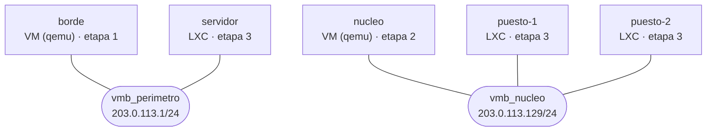

<!-- PROPÓSITO:   el documento del lab `03_lab-dos-redes`. Dos regiones: la generada
     (datos derivados de la declaración) y la prosa (lo que el YAML no puede decir).
     INVARIANTES: dentro de los marcadores no se escribe a mano; `./lab check docs`
     falla si difiere del render. Fuera, ningún check opina.
     LÍMITES:     la prosa no repite valores que ya están en la tabla: los cita.
     VER:         AGENTS.md §Documentación; README.md §Documentación -->
# 03_lab-dos-redes

La topología que sube una etapa respecto al lab de tres dispositivos: **dos redes
separadas —perímetro y núcleo—, cinco invitados en tres etapas de arranque, dos
de ellos VMs**. Donde el lab de tres dispositivos tenía un bridge, dos etapas y
una sola VM, aquí hay dos bridges, tres etapas y dos VMs, repartidos en las dos
ramas del motor (QEMU y LXC) y en dos redes que no comparten direccionamiento.

Sirve para lo que un lab de un solo segmento no puede enseñar: que el orden de
arranque **atraviesa** la topología (el borde primero, el núcleo después, los
extremos al final), que un mismo plan convive con varias redes declaradas a la vez,
y que el motor no sabe nada de ninguna de las dos —el reparto entre `perimetro` y
`nucleo` vive entero en la declaración, no en el código—.

<!-- generado:inicio -->
_Datos derivados de `03_lab-dos-redes.yml`. Los reescribe `./lab check docs --actualizar`;
si los editas a mano, `./lab check docs` falla._

## Topología



## Invitados declarados

| rol | tipo | stage | cores | memory (MB) | disk (GB) | bridge | address |
| --- | --- | --- | --- | --- | --- | --- | --- |
| borde | VM (qemu) | 1 | 2 | 512 | 8 | vmb_perimetro | 203.0.113.2/24 |
| nucleo | VM (qemu) | 2 | 2 | 1024 | 8 | vmb_nucleo | 203.0.113.130/24 |
| puesto-1 | LXC | 3 | 1 | 512 | 4 | vmb_nucleo | 203.0.113.131/24 |
| puesto-2 | LXC | 3 | 1 | 512 | 4 | vmb_nucleo | 203.0.113.132/24 |
| servidor | LXC | 3 | 1 | 512 | 6 | vmb_perimetro | 203.0.113.21/24 |

## Bridges del lab

| bridge | dirección del bridge |
| --- | --- |
| vmb_perimetro | 203.0.113.1/24 |
| vmb_nucleo | 203.0.113.129/24 |

## Orden de arranque (etapas)

| stage | roles |
| --- | --- |
| 1 | borde |
| 2 | nucleo |
| 3 | puesto-1, puesto-2, servidor |

## Identidad: la deriva el motor, no la declara el lab

| rol | tipo | nombre canónico | vmid | MAC |
| --- | --- | --- | --- | --- |
| borde | VM (qemu) | {equipo}-{alias} | — | — |
| nucleo | VM (qemu) | {equipo}-{alias} | — | — |
| puesto-1 | LXC | {equipo}-{alias} | — | — |
| puesto-2 | LXC | {equipo}-{alias} | — | — |
| servidor | LXC | {equipo}-{alias} | — | — |

El **vmid** (el menor libre de *todo* el clúster) y la **MAC** (`BC:24:11` + los
bytes del vmid) los asigna `apply` leyendo el estado de Proxmox: no se declaran aquí y
no se guardan en ningún fichero del repositorio. Por eso estas dos columnas son un
guion hasta que exista un despliegue real.

## Cómo se entra a cada equipo

| rol | tipo | usuario | credencial | forma de acceso |
| --- | --- | --- | --- | --- |
| borde | VM (qemu) | — | — | no se entra: no declara `config:` |
| nucleo | VM (qemu) | — | — | no se entra: no declara `config:` |
| puesto-1 | LXC | — | — | no se entra: no declara `config:` |
| puesto-2 | LXC | — | — | no se entra: no declara `config:` |
| servidor | LXC | — | — | no se entra: no declara `config:` |

El **usuario**, la **credencial** (de dónde sale Y cuánto vale) y la **forma de acceso** se
derivan de la declaración, del motor y de `deployment_engine/secrets.yml`. **Este lab es de un
solo uso y la contraseña se escribe aquí a la vista a propósito** (decisión explícita del dueño
del repo): es un cuadro de acceso, no un secreto — en un lab efímero prima poder entrar. El
puerto sale del **vmid**, que no se conoce hasta `apply`: por eso va como fórmula (`base`+vmid)
y el número de verdad lo dice el despliegue. Un invitado sin `config:` no se toca, y su fila lo
dice en vez de fingir un acceso que no hay. (En un Linux la credencial **no es una contraseña**:
es el **fichero** de la clave del lab, y por eso se enseña su ruta, no un valor.)
<!-- generado:fin -->

## Cómo llevarlo a un Proxmox real

Los pasos, en orden. Este lab **se ha desplegado y verificado contra un Proxmox
real**; más abajo queda anotado lo que se aprendió al hacerlo.

1. **Rellena las credenciales** (no se versionan; se escriben a mano, ya no hay
   `.example` que copiar):
   ```
   $EDITOR deployment_engine/secrets.yml
   chmod 600 deployment_engine/secrets.yml
   ```
   Las claves y qué significa cada una están en el README, §«Las credenciales se
   escriben a mano». En corto: `pve_nodo` (el host de la API), `pve_nombre_nodo`
   (el nombre con el que Proxmox conoce al nodo, el de `/nodes/<nombre>/...`),
   `pve_puerto` (8006 por defecto), `pve_token_id` y `pve_token_secreto`.

2. **Sustituye las direcciones del lab.** Este lab declara direcciones en
   `203.0.113.0/24`, que es un rango reservado para documentación (RFC 5737) y no
   existe en ninguna red real. Edita `03_lab-dos-redes.yml` y pon las tuyas. Ojo: hoy
   esas direcciones son el **plan de direccionamiento** del lab, no algo que el
   motor escriba en el invitado ni en el bridge (ver «Un límite que se ve al leer
   la topología»). Los dos nombres de bridge ya cumplen el formato que el núcleo
   exige (sin guiones, 2 a 15 caracteres): el motor rechaza los que no lo cumplen
   antes de tocar la API.

3. **Mira el plan** (no toca nada):
   ```
   ./lab --lab 03_lab-dos-redes plan --api
   ```
   Sin `--api`, `plan` usa un clúster vacío simulado y sirve igual para revisar el
   orden de las llamadas.

4. **Pregunta qué hay y qué falta**, sólo lectura:
   ```
   ./lab --lab 03_lab-dos-redes preflight
   ```

5. **Converge**:
   ```
   ./lab --lab 03_lab-dos-redes apply
   ```
   `apply` ejecuta exactamente el plan que acabas de ver: crea el pool, crea los
   bridges que falten y recarga la red del nodo una sola vez, crea o ajusta cada
   invitado y los arranca por etapas.

6. **Verifica** contra la API, que es el único test que no se cree a sí mismo:
   ```
   ./lab --lab 03_lab-dos-redes verify
   ```

7. **Destruye** cuando ya no lo quieras (borra los invitados del lab, su pool si ha
   quedado vacío y, al final, **los bridges que creó él** —los que llevan su marca en
   el `comments` y que ya no usa nadie—, con **una** recarga de red):
   ```
   ./lab --lab 03_lab-dos-redes destroy
   ```
   El verbo dice bridge a bridge qué se lleva y qué conserva, y por qué. Un bridge
   que ya estaba en el nodo antes de que el lab llegara no lleva marca: se queda
   donde está, y quitarlo es cirugía a mano en Proxmox.

## Por qué así

### Dos redes y no una

Un lab de un solo segmento no distingue «el bridge del lab» de «la red del lab»:
con un bridge, la pregunta no se plantea. Con dos, el motor tiene que crear **los
que falten** (los bridges son del nodo, no del pool: Proxmox no los mete en
ningún pool) y recargar la red del nodo **una vez** para que los dos entren en
vigor, no una vez por bridge. Eso es lo que se ve en el plan: dos `POST` a
`/nodes/<nodo>/network` y un único `PUT` de recarga al final.

### Tres etapas y no dos

El orden de arranque es parte de la declaración, no del código: el motor sólo sabe
«arranca la etapa 1, luego el 2, luego el 3», y no hay ni un nombre de rol dentro
de `deployment_engine/`. Aquí el orden tiene sentido físico —primero la vía de acceso,
después el conmutador que da red al segundo segmento, y sólo entonces los extremos—
y ese orden se lee entero en el YAML.

### Dos VMs y tres contenedores

El lab de tres dispositivos ejercita las dos ramas del motor una vez. Aquí la rama
QEMU aparece dos veces y en etapas distintos, que es donde se nota si el motor
trata igual a los dos tipos: la red de una VM se declara `virtio=<mac>` y la de un
contenedor `name=eth0,bridge=...,hwaddr=<mac>`, y esa diferencia está en un solo
sitio (`tools/plan.py`), no repartida por los playbooks.

### Un límite que se ve al leer la topología

**Este** lab declara un bridge y una dirección por invitado, así que no declara un
cortafuegos con una interfaz en cada red: la interconexión entre perímetro y núcleo **no
se declara**, y las dos redes quedan aisladas entre sí. No es un olvido de esta
declaración ni un límite del motor: el esquema **sí** admite varias interfaces por
invitado (`bridges:` como lista) y el lab de aceptación las usa. Aquí se elige una
por invitado, y se dice, en vez de maquillarlo con una topología que aparente lo que
no hay.

Otros límites, los mismos de cualquier lab de este repositorio, y uno de este que
conviene tener delante:

- **La dirección IP declarada de cada rol no es verificable por API**: vive dentro
  del invitado y la configuración del hipervisor no la guarda. `verify` compara el
  bridge y la MAC (que sí están en la config) y lo dice en voz alta en lugar de dar
  por bueno lo que no ha mirado. Y como **este** lab no declara `config:`, el motor
  no la escribe dentro tampoco: es el plan de direccionamiento, no una dirección
  puesta. (En un lab con interior, el motor sí la aplica y la relee.)
- **La dirección del bridge se declara y no se envía**: el `POST` que crea un
  bridge manda `iface`, `type`, `autostart` y el `comments` con la marca del motor, y
  nada de `address`/`cidr`. Los dos bridges de este lab existen, están activos y
  arrancan solos, pero salen con `method=manual` y **sin** dirección: la del YAML es
  intención documentada.
- **`disk` se declara y se valida, pero la API no recibe ninguna orden de disco**:
  el plan no inventa recursos que la API no da, y una plantilla de disco es uno de
  ellos (`tools/plan.py` lo deja escrito). Los tres contenedores se crean con el
  tamaño por defecto de la plantilla, también el que declara más de lo que la
  plantilla da.

Ninguno de los tres lo detecta `verify`: compara existencia, nombre, cores,
memoria, bridge, MAC y descripción, que es lo que la API guarda. El hueco está
dicho aquí, que es el único sitio donde cabe decirlo.

### Lo que se aprendió al desplegarlo de verdad

*(Archivo de lo ejecutado, no de lo previsto: esto no son hipótesis, es lo que
pasó al correrlo contra el Proxmox real.)*

- **El plan y lo que pasa cuadran, y eso se puede comprobar.** El plan anunció 14
  llamadas REST (crear pool, dos bridges, una recarga, cinco invitados, cinco
  arranques) y el primer `apply` terminó con `changed=14`. Un segundo `apply`
  seguido no hizo ni una escritura: `changed=0` y el diario de la API de esa
  corrida no tiene ni un método que no sea `GET`. Es la prueba de idempotencia que
  el motor se puede hacer a sí mismo sin creerse.
- **El asignador toma el menor vmid libre de TODO el clúster, no del pool.** Si el
  nodo ya tiene invitados sueltos fuera de cualquier pool, los vmids del lab salen
  salteados: no son un rango contiguo ni el orden de creación. Se ve al mirar la
  tabla de identidad de un despliegue real, y es el motivo de que esa tabla no se
  rellene a mano.
- **Los bridges son del nodo, y por eso se borran con dos pruebas.** `destroy` se
  lleva los invitados y el pool, y además los bridges **que creó él**: los reconoce
  por la marca que les dejó el plan en el `comments` (`lab=<lab> gestionado por
  netlabs_v4_b`) y comprueba antes que **ningún invitado de fuera del lab** los esté
  usando. Un bridge que ya estaba en el nodo cuando el lab llegó no se marca y no se
  borra: es del nodo. Y un bridge borrado sigue activo hasta que el nodo recarga su
  red, así que la recarga se hace **una vez** al final y sólo si de verdad cayó
  alguno. Lo que sigue sin tener verbo son esos bridges sin marca: limpiarlos es
  cirugía del nodo, no del despliegue.
- **La recarga de red es el paso que más tarda y el único que toca el nodo.** Los
  `POST`/`DELETE` de invitados van contra el pool del lab; el `PUT` de recarga
  reescribe `/etc/network/interfaces` del nodo y corre `ifreload -a`. Si esa
  recarga falla, el bridge queda creado en el fichero pero sin activar, y el
  invitado que lo use se queda sin red: merece la pena mirar la respuesta antes de
  dar el despliegue por bueno.
- **La creación es asíncrona y el motor la espera.** Cada `POST` devuelve un UPID y
  el motor sondea `GET /nodes/<n>/tasks/<upid>/status` hasta que la tarea deja de
  estar en marcha; sin esa espera, el `start` choca con el bloqueo de la creación y
  `verify` ve invitados «parados» que en realidad están arrancando.

## Ver también (punteros al código)

- La vía de acceso única a la API y el diario de cada llamada:
  [deployment_engine/tasks/pve_api.yml](../../deployment_engine/tasks/pve_api.yml)
- El asignador de identidad (vmid, nombre canónico, MAC):
  [deployment_engine/filter_plugins/identidad.py](../../deployment_engine/filter_plugins/identidad.py)
- El cálculo del plan ordenado (bridges, etapas y las dos formas de `net0`):
  [deployment_engine/tools/plan.py](../../deployment_engine/tools/plan.py)
- Los checks del motor, incluido `colisiones`:
  [deployment_engine/tools/framework_check.py](../../deployment_engine/tools/framework_check.py)
- Por qué el pool es la frontera de propiedad:
  [docs/decisiones/0002-el-pool-como-frontera-de-propiedad.md](../../docs/decisiones/0002-el-pool-como-frontera-de-propiedad.md)
