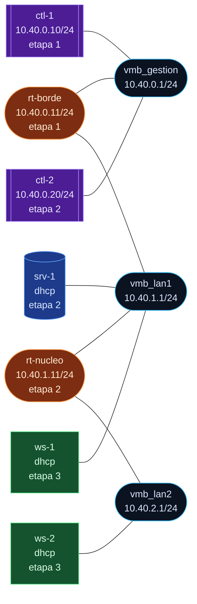

# 04_lab-red-routeros

El lab de aceptación de la capa de configuración: **dos routers RouterOS (CHR)
encadenados y un bastión**, con servidores y puestos como contenedores.
Es el lab que hace medir de verdad lo que el encargo de la fase 2 promete: que el
motor **entra** en cada equipo, lo **converge** y sabe **quitar lo que sobra**, sin
que nadie más toque el hipervisor ni la red del lab.

<!-- generado:inicio -->
_Datos derivados de `04_lab-red-routeros.yml`. Los reescribe `./lab check docs --actualizar`;
si los editas a mano, `./lab check docs` falla._

## Topología

En el diagrama, la **forma** y el **color** de cada equipo dicen qué es (el tipo declarado):

- `rt` — rt (enruta y sale)
- `srv` — srv (servidor)
- `ws` — ws (puesto de trabajo)
- `ctl` — ctl (control del lab)

## Invitados declarados

| rol | tipo | plataforma | stage | cores | memory (MB) | disk (GB) | bridge | address |
| --- | --- | --- | --- | --- | --- | --- | --- | --- |
| borde | rt (enruta y sale) | VM (qemu) | 1 | 2 | 512 | 1 | vmb_gestion + vmb_lan1 | 10.40.0.11/24 |
| control | ctl (control del lab) | LXC | 1 | 1 | 512 | 4 | vmb_gestion | 10.40.0.10/24 |
| monitor | ctl (control del lab) | LXC | 2 | 2 | 2048 | 8 | vmb_gestion | 10.40.0.20/24 |
| nucleo | rt (enruta y sale) | VM (qemu) | 2 | 1 | 512 | 1 | vmb_lan1 + vmb_lan2 | 10.40.1.11/24 |
| servidor | srv (servidor) | LXC | 2 | 1 | 512 | 4 | vmb_lan1 | dhcp |
| puesto-1 | ws (puesto de trabajo) | LXC | 3 | 1 | 512 | 4 | vmb_lan1 | dhcp |
| puesto-2 | ws (puesto de trabajo) | LXC | 3 | 1 | 512 | 4 | vmb_lan2 | dhcp |

## Bridges del lab

| bridge | dirección del bridge |
| --- | --- |
| vmb_gestion | 10.40.0.1/24 |
| vmb_lan1 | 10.40.1.1/24 |
| vmb_lan2 | 10.40.2.1/24 |

## Orden de arranque (etapas)

| stage | roles |
| --- | --- |
| 1 | borde, control |
| 2 | monitor, nucleo, servidor |
| 3 | puesto-1, puesto-2 |

## Identidad: la deriva el motor, no la declara el lab

| rol | tipo | nombre canónico | vmid | MAC |
| --- | --- | --- | --- | --- |
| borde | rt (enruta y sale) | rt-borde | — | — |
| control | ctl (control del lab) | ctl-1 | — | — |
| monitor | ctl (control del lab) | ctl-2 | — | — |
| nucleo | rt (enruta y sale) | rt-nucleo | — | — |
| servidor | srv (servidor) | srv-1 | — | — |
| puesto-1 | ws (puesto de trabajo) | ws-1 | — | — |
| puesto-2 | ws (puesto de trabajo) | ws-2 | — | — |

El **vmid** (el menor libre de *todo* el clúster) y la **MAC** (`BC:24:11` + los
bytes del vmid) los asigna `apply` leyendo el estado de Proxmox: no se declaran aquí y
no se guardan en ningún fichero del repositorio. Por eso estas dos columnas son un
guion hasta que exista un despliegue real.

## Cómo se entra a cada equipo

| rol | tipo | usuario | credencial | forma de acceso |
| --- | --- | --- | --- | --- |
| borde | rt (enruta y sale) | admin | `admin` / la de `secrets.yml` → `routeros_clave` (HTTP Basic) | REST por el túnel del bastión (`21000`+vmid); su consola, por la serial del nodo |
| control | ctl (control del lab) | root | clave del lab (`~/.ssh/netlabs_tunnel_04_lab-red-routeros_ed25519`), sin contraseña | SSH a `127.0.0.1`:(`20000`+vmid): él ES el bastión, se entra directo por su túnel |
| monitor | ctl (control del lab) | root | clave del lab (`~/.ssh/netlabs_tunnel_04_lab-red-routeros_ed25519`), sin contraseña | SSH por el bastión (salta por su túnel), a su dirección en el lab |
| nucleo | rt (enruta y sale) | admin | `admin` / la de `secrets.yml` → `routeros_clave` (HTTP Basic) | REST por el túnel del bastión (`21000`+vmid); su consola, por la serial del nodo |
| servidor | srv (servidor) | root | clave del lab (`~/.ssh/netlabs_tunnel_04_lab-red-routeros_ed25519`), sin contraseña | SSH por el bastión (salta por su túnel), a su dirección en el lab |
| puesto-1 | ws (puesto de trabajo) | root | clave del lab (`~/.ssh/netlabs_tunnel_04_lab-red-routeros_ed25519`), sin contraseña | SSH por el bastión (salta por su túnel), a su dirección en el lab |
| puesto-2 | ws (puesto de trabajo) | root | clave del lab (`~/.ssh/netlabs_tunnel_04_lab-red-routeros_ed25519`), sin contraseña | SSH por el bastión (salta por su túnel), a su dirección en el lab |

El **usuario**, la **credencial** (de dónde sale Y cuánto vale) y la **forma de acceso** se
derivan de la declaración, del motor y de `deployment_engine/secrets.yml`. **Este lab es de un
solo uso y la contraseña se escribe aquí a la vista a propósito** (decisión explícita del dueño
del repo): es un cuadro de acceso, no un secreto — en un lab efímero prima poder entrar. El
puerto sale del **vmid**, que no se conoce hasta `apply`: por eso va como fórmula (`base`+vmid)
y el número de verdad lo dice el despliegue. Un invitado sin `config:` no se toca, y su fila lo
dice en vez de fingir un acceso que no hay. (En un Linux la credencial **no es una contraseña**:
es el **fichero** de la clave del lab, y por eso se enseña su ruta, no un valor.)
<!-- generado:fin -->

## Por qué así

### El arranque en frío, en orden (y por qué el orden es el diseño)

El problema que este lab resuelve de verdad no es «configurar un router»: es **cómo
se le da una dirección al primer equipo**, cuando todavía no hay nadie dentro que
pueda configurar nada. La cadena, tal como queda:

1. **El bastión nace completo**: una interfaz en el bridge de gestión del nodo
   (por donde sale hacia casa) y una por cada bridge del lab -- la declaración tiene
   `vmb_gestion`, `vmb_lan1` y `vmb_lan2`, así que nace con cuatro interfaces. **Nace**
   con todas, no se le añaden después: cambiarle las interfaces a un invitado en marcha
   obliga a reiniciarlo, y aquí no se reinicia la máquina que está trabajando.
2. **El motor le deja su clave al crearlo** (`ssh-public-keys` en la API de creación
   de un LXC: Proxmox la escribe en el rootfs, sin `snippets` ni cloud-init).
3. **El motor entra UNA vez por su consola** y le manda UNA línea (en base64) que
   levanta el túnel hacia el nodo de control. A partir de ahí el bastión es
   el bastión del lab: Ansible llega a todo lo que cuelgue de sus bridges.
4. **El bastión configura su servidor DHCP** y reserva, por la **MAC
   derivada del vmid** de cada CHR, la dirección que ese CHR declara. Nadie escribe
   una MAC en ningún sitio.
5. **El primer CHR** (etapa 1) arranca sin dirección y la pide por DHCP. Es
   **tolerante**: pide sin parar hasta que le contestan, así que puede compartir
   etapa con el bastión.
6. **El motor ya lo alcanza** en su dirección declarada y hace la primera
   convergencia: identidad, servicios, direcciones y su propio servidor DHCP.
7. **El segundo etapa** (el otro CHR y el servidor) cuelga del primero, y su
   dirección está reservada por él. Aquí se ve el encadenamiento: el que da la
   dirección ya está convergido antes de que el otro arranque.
8. **Los puestos**, en el tercer etapa, con `address: dhcp`: no arrancan hasta
   que su CHR está sirviendo.

Nada de esto depende de que un humano lance las cosas en el orden correcto: el orden
está en los `stages` de la declaración, y el plan lo respeta (regla 18).

### Lo que se aprendió ejecutando

<!-- Esta sección es para lo MEDIDO, no para lo previsto. Lo que no se haya medido
     de verdad contra el VPS no se escribe aquí: se dice que falta. -->

- **El bug de la espacio de direcciones, cazado por este lab.** El validador daba por buena la
  espacio de direcciones con una comparación de prefijo mal hecha: decía que `10.40.0.1/24` **no**
  caía dentro de `10.40.0.0/16`. Ningún lab anterior declaraba espacio de direcciones --los tres de
  la fase 1 no tienen interior-- así que la comprobación no se había ejercitado
  nunca. Lo cazó este lab, y ahora tiene sus casos en `test/test_declaracion.py`.
- **Las áreas que el motor todavía no converge se rechazan, no se ignoran.** El
  encargo nombra `puentes` y `cortafuegos` (RouterOS) y `gateway`, `rutas`, `dns` y
  `claves` (Linux) como áreas del vocabulario; el motor aún no las sabe converger, así
  que están declaradas como **pendientes** y la validación las rechaza con su motivo.
  Este lab no las declara: aquí no se finge una configuración que no se aplica.
- **El motor entra de verdad en el invitado, y se ve en el diario.** El 14-nov-2026, con
  el bastión recreado, las cuatro lecturas del driver salen `rc=0` en
  `logs/interior.jsonl` (`tunnel=active`, `address=10.40.0.10/24`, `ip_forward=1`). Antes
  de recrearlo salían `rc=255`: la clave que el invitado tenía dentro era la genérica
  vieja. La lección es la clave **por lab** y **para los dos sentidos** (entrar y salir),
  porque un invitado creado con otra clave da `Permission denied` y el motor no lo puede
  adivinar: lo dice y para.
- **La imagen base no trae servidor DHCP ni `ethtool`, y `ip link` no los sustituye.**
  Medido dentro del invitado: sin `dnsmasq` ni `ethtool` en `/usr/sbin`, y
  `ip link set dev eth0 tx off / gso off / tso off` rechazado por iproute2. El motor los
  instala **en su aparato** (el bastión) y escribe la configuración con la
  reserva derivada del vmid: quedó medido dentro, la reserva del CHR con su MAC derivada y
  su dirección (el vmid sale del asignador, no se escribe), `dnsmasq` escuchando en
  `eth0:67` y los tres offloads en `off`.
- **La segunda pasada del interior no escribe NADA.** El 14-nov-2026, `apply` dos veces
  seguidas: la segunda dejó en el diario del interior **cuatro lecturas y cero
  escrituras**. Es la prueba de la idempotencia que la regla 6 pide, hecha sobre el
  invitado de verdad y no sobre el plan. Costó encontrarla: el motor pedía reescribir el
  fichero del DHCP y recargar el servicio en cada pasada porque no leía el estado del
  servicio ni normalizaba el rango declarado contra el que escribe dnsmasq (ver ADR 0005).
- **La ley de RouterOS se resolvió por el túnel que el ADR 0006 §5 tenía escrito: el
  intercambio lo hace el ROUTER, entero y de una vez.** El driver de RouterOS lee y decide
  contra el CHR de verdad (identidad, usuarios, claves, direcciones, servicios, cliente DHCP,
  rutas, servidores/rangos/redes/concesiones) y el baile de credenciales funciona (**401** con
  la clave del motor, **200** con la de fábrica). La escritura de la dirección de gestión de
  `borde` pinchaba con **400 `already have such address`** (el cliente de fábrica ya la tiene
  puesta, y apagarlo antes se lleva la dirección y con ella el REST). El arreglo no fue ni
  `ignore_errors` ni entrar por otra interface: fue **intercambiar la gestión de sitio** — se entra
  por `POST /execute` con la dirección nueva (que NO revalida la de gestión, sólo el token) y
  desde dentro se reescribe el direccionamiento entero, para que el cliente pase a la nueva y
  la vieja quede libre. Medido el 14-nov-2026: `borde` converge en UNA pasada.
- **La sonda de la etapa va DELANTE del interior, y ésa fue la última pared.** Con la
  dirección de gestión resuelta, `apply` seguía muriendo al converger el SEGUNDO CHR
  (`nucleo`, su dirección en `vmb_lan1`) con **`No route to host`**: el plan lo convergía
  NADA MÁS ARRANCARLO, y un CHR tarda en bootear y en pedir su dirección por DHCP. La interfaz del
  bastión en esa LAN ya estaba bien (y la dirección reservada, también): el muro era
  el **tiempo**, no la red. El arreglo es del plan (`tools/plan.py`): `esperar_servicio` se
  antepone a `pasos_de_convergencia` de cada invitado (orden de arranque), así que sólo se
  converge lo que ya contesta. Medido el 14-nov-2026: `nucleo` converge.
- **Un invitado que sólo declara una dirección dinámica NO se entra.** `servidor` y los
  puestos declaran `config: linux: {}` con `address: dhcp`: su única área es una dirección
  que **se lee del host** (`GET /nodes/<nodo>/lxc/<vmid>/interfaces`, §6.3), no algo que se
  configure dentro — y además no se sabe a dónde conectar para entrar (un círculo). El motor
  no entra a ciegas (regla 16), así que no se emite paso para él. Un `dhcp` **con** áreas que
  pidan entrar lo caza la validación antes de tocar nada.
- **El ciclo completo, verde y en UNA pasada (14-nov-2026, contra el VPS).**
  `destroy --yes` → `apply` → `verify` dio **«verificación CORRECTA: 6 invitados existen,
  coinciden y están arrancados»** (`logs/verify-*.json`), con `./lab check` en verde. La
  **segunda** pasada de `apply` no cambia el mundo: el diario de la API queda **sólo con
  `GET`** y el del interior **sin una sola escritura** (regla 6).
- **Dos trampas del transporte, las dos medidas, y las dos dan «timeout» en vez de error.**
  Un GET con `body_format: json` (aunque el cuerpo se omita) deja al CHR **sin contestar**,
  y el disco de la VM en `scsi0` deja al equipo **sin arrancar** (SeaBIOS: `Load system /
  ERROR: could not find disk!`, bucle de iPXE) — con la VM `running` y `verify` dándola por
  conforme. Las dos se arreglaron en el motor: el formato del cuerpo sólo se declara al
  escribir (`ros_api.yml`), y el bus del disco lo decide lo que el invitado declara ser por
  dentro, no el nombre de la imagen (`plan.py`). Medido de paso: RouterOS tarda **~4,7 s
  por llamada**, así que los timeouts por defecto no valen.
- **El orden de las áreas lo manda el motor, no el lab.** `AREAS` (`interior.py`) pone
  `addresses` antes de `dhcp_client` justo por eso, y `test/test_routeros.py` compara la
  lista de operaciones entera para que nadie lo deshaga sin enterarse.
- **El túnel del bastión lleva también el REST, y el CHR deja de costar 4,4 s
  (15-nov-2026, ADR 0010).** El motor ya no le **delega** la llamada al puesto: el mismo
  túnel `ssh -R` que lee su consola reenvía ahora el puerto 80 de cada CHR, y las 99 llamadas
  REST del `apply` pasan de **4,39 s a 0,50 s** de media (434,5 s → 49,7 s de suma; el
  `apply` entero, 1.028,7 s → **650 s**). No era la red —el CHR está a 3 ms—, era subir
  Python por SSH en cada petición. La trampa que se comió una pasada entera del ciclo:
  `permitlisten` **se repite**, no se lista dentro de la opción —con
  `permitlisten="20103,21102"` sshd **no encuentra la clave** y contesta `Permission denied
  (publickey)`, un error que señala a la clave y no al `authorized_keys`—; lo vigila
  `test/test_interior.py`.
- **Lo que queda, dicho en voz alta.** `verify` todavía NO comprueba el interior (no entra
  a leer las áreas para cotejarlas): verifica el mundo de la API. La comprobación de un
  invitado dinámico por el host y sus concesiones (§6.3) y la del interior por áreas (§11)
  son el tramo siguiente; el ciclo verde de hoy lo es sin ellas, y eso se dice, no se
  maquilla.

### El terminal de los dos routers, dentro de la web del vigilante (20-nov-2026, ADR 0035)

Este lab tiene **dos** `rt`, así que es el primero donde una consola única tiene algo que
enseñar. El vigilante declara `servicio: netxms` y `terminal: {}` — pero **en su propio
invitado, `ctl-2`**, no en el bastión (`ADR 0029 §B`): el bastión es la forma de entrar del
motor, y meterle un JVM con PostgreSQL al lado significa que un `apt upgrade` o el OOM killer
se llevan el túnel del lab. Así lo hace también el lab 08 con su `monitor`, y aquí se había
hecho mal durante un día: el vigilante vivía en `ctl-1` con el argumento de que «es el único
que alcanza las dos redes», que es justo lo que 0029 resolvió generalizando la pata de
gestión — un invitado que publica un servicio lleva **sus** interfaces y la salida, así que
`ctl-2` llega a la LAN del CHR como se llega a cualquier red: con una **ruta** por el
router que la sirve (`10.40.1.0/24 via 10.40.0.11`), no con una dirección de esa LAN puesta
en su tarjeta de salida. La primera versión declaraba `addresses: eth1 10.40.1.3/24`, y el
motor la aplicó donde tocaba —en `eth1`—, que es la pata de gestión (`vmbr1`): una dirección
en una red en la que el invitado no está. El terminal abría la ventana y no llegaba a
`rt-nucleo`.

Y una trampa del nodo, que no es del lab: el nodo llega a `10.40.0.x` por la dirección
`10.40.0.254` que le pone la unidad `netlabs-publicacion` en `vmb_gestion`. `destroy` borra
ese bridge y con él se va la dirección, así que tras un ciclo la consola daba 502 hasta
reiniciar la unidad a mano. Ahora hay un `netlabs-publicacion.timer` (calendario, cada
minuto) que la repone sola. Con `OnUnitActive/InactiveSec` no servía: el servicio lleva
`RemainAfterExit` y nunca pasa a inactivo, así que se disparaba una vez y se quedaba quieto.

Lo que costó entenderlo, y que ahora está escrito en el código: **el terminal no lo presta
el servidor**. La sesión SSH la abre un agente con el subagente `ssh.nsm`, y el servidor sólo
transporta bytes. Tres piezas, y sin cualquiera de ellas el API contesta **502 «Cannot
connect to SSH proxy agent»** con todo lo demás en su sitio:

1. el agente carga `ssh.nsm` **en `[CORE]`** (al final del fichero la línea cae en
   `[FILEMGR]` y no se carga);
2. el nodo del propio vigilante lleva `NC_IS_NATIVE_AGENT` (`0x2`) además de `NC_IS_SSH`
   (`0x80`) — el motor hace `OR` sobre el nodo que ya viene marcado como gestión local;
3. cada router es un **nodo** con `ssh_login`/`ssh_password`/`ssh_port` y `ssh_proxy = 0`
   («el agente de este servidor»).

Capacidades y credenciales se leen **al arrancar**: por eso la escritura termina en un
reinicio, y sólo cuando algo cambió. La credencial no viaja en la línea de órdenes —va a
`/etc/netlabs/terminal.env` (0600), y el paso se diariza con `comando_diario`—: el diario
cuenta lo que se hizo, no el secreto.

**La cuarta pieza, medida al abrir el primer terminal (20-nov-2026).** Con las tres puestas,
`Tools > SSH terminal` sobre `rt-borde` abrió la ventana y la cerró con *«TCP proxy function
is disabled»*. La sesión es una conexión TCP que nace en el **agente**, y su configuración no
traía `EnableTCPProxy`: sin `AF_ENABLE_TCP_PROXY` el agente la rechaza aunque todo lo demás
esté en su sitio. Ya va en `/etc/nxagentd.conf`, y el área no se cree el fichero: exige que el
proceso del agente sea **posterior** a él, porque las banderas se leen al arrancar y un fichero
nuevo sobre un proceso viejo no arregla nada. La escritura compara antes de escribir y reinicia
el agente en ese mismo paso. En el diálogo, la ruta que funciona es *Through NetXMS SSH proxy
(session established by proxy agent)*, con usuario `admin` y la clave del router; la otra
—conexión directa— necesitaría que el navegador alcanzara la red del equipo.

### La consola del vigilante, con nombre: `04.netxms.matadepera.eu` (20-nov-2026)

El vigilante de este lab se visita desde fuera en
**https://04.netxms.matadepera.eu** — su consola web (el Tomcat del vigilante `ctl-2`, contexto
`/nxmc/`), que es donde se abren los terminales de los `rt`. La cadena no la monta el motor:

1. `*.matadepera.eu` resuelve al nodo;
2. el nodo manda `:80` y `:443` al **proxy de la zona** (10.10.10.2), que termina el TLS con
   su certificado y tiene un bloque por lab: `04.netxms.matadepera.eu → 10.40.0.20:8080`, que
   es el **vigilante** (`ctl-2`, el `monitor`), no el bastión: el bastión ya no corre el
   vigilante (ADR 0029);
3. el proxy llega al bridge de gestión porque el **nodo tiene una dirección en él**
   (`10.40.0.254/24`, la unidad `netlabs-publicacion` del nodo); sin ella saldría a la calle y
   volvería. No confundirla con el `address:` del bridge en la declaración (10.40.0.1): ése es
   la puerta que se le DICE a los invitados, y el motor no la pone en el nodo.

Lo que el motor garantiza es lo suyo: que el vigilante **sirve** —la comprobación entra por su
API autenticando, no mira el proceso— y que su consola escucha. Publicar un lab nuevo son dos
líneas en el proxy de la zona (un bloque) y ninguna en la declaración; lo aprendido al hacerlo
está en la skill (`references/publicacion-web.md`).
