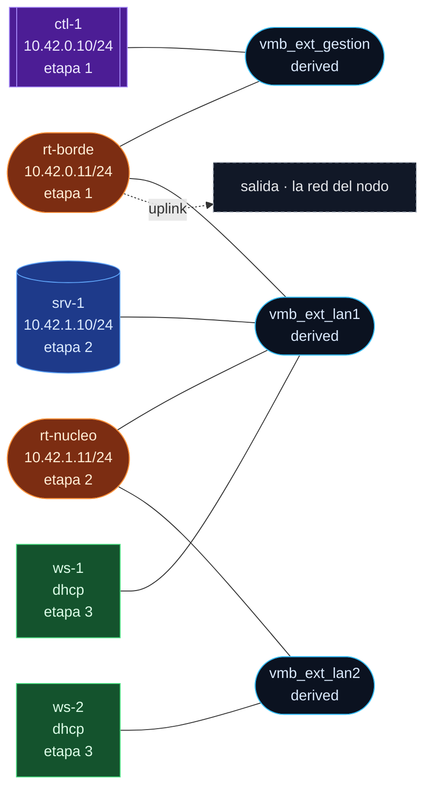

<!-- PROPÓSITO:   el documento del lab `06_conectividad-exterior`. Dos regiones, dos escritores.
     INVARIANTES: la región generada (entre los marcadores) la reescribe
                  `./lab check docs --actualizar`; `./lab check docs` falla si el
                  fichero difiere de su render. La prosa de fuera NO la toca ningún
                  check: escribe lo que el YAML no puede decir.
     LÍMITES:     la prosa no repite valores que ya están en la tabla; los cita.
     VER:         AGENTS.md §Documentación; README.md §Documentación;
                  docs/crear-un-lab.md (la guía de campo: las decisiones, en orden) -->

# 06_conectividad-exterior

El lab de aceptación (`04_lab-red-routeros`) demuestra que cada invitado toma su dirección
del router que le toca. Éste demuestra lo que viene después: que lo que cuelga de esas
redes **sale a internet**, con el router de arriba declarado como la salida (`uplink`).

<!-- generado:inicio -->
_Datos derivados de `06_conectividad-exterior.yml`. Los reescribe `./lab check docs --actualizar`;
si los editas a mano, `./lab check docs` falla._

## Topología

En el diagrama, la **forma** y el **color** de cada equipo dicen qué es (el tipo declarado):

- `rt` — rt (enruta y sale)
- `srv` — srv (servidor)
- `ws` — ws (puesto de trabajo)
- `ctl` — ctl (control del lab)

## Invitados declarados

| rol | tipo | plataforma | stage | cores | memory (MB) | disk (GB) | bridge | address |
| --- | --- | --- | --- | --- | --- | --- | --- | --- |
| borde | rt (enruta y sale) | VM (qemu) | 1 | 2 | 512 | 1 | vmb_ext_gestion + vmb_ext_lan1 | 10.42.0.11/24 |
| control | ctl (control del lab) | LXC | 1 | 1 | 512 | 4 | vmb_ext_gestion | 10.42.0.10/24 |
| nucleo | rt (enruta y sale) | VM (qemu) | 2 | 1 | 512 | 1 | vmb_ext_lan1 + vmb_ext_lan2 | 10.42.1.11/24 |
| servidor | srv (servidor) | LXC | 2 | 1 | 512 | 4 | vmb_ext_lan1 | 10.42.1.10/24 |
| puesto-1 | ws (puesto de trabajo) | LXC | 3 | 1 | 512 | 4 | vmb_ext_lan1 | dhcp |
| puesto-2 | ws (puesto de trabajo) | LXC | 3 | 1 | 512 | 4 | vmb_ext_lan2 | dhcp |

## Bridges del lab

| bridge | dirección del bridge |
| --- | --- |
| vmb_ext_gestion | derived |
| vmb_ext_lan1 | derived |
| vmb_ext_lan2 | derived |

## Orden de arranque (etapas)

| stage | roles |
| --- | --- |
| 1 | borde, control |
| 2 | nucleo, servidor |
| 3 | puesto-1, puesto-2 |

## Identidad: la deriva el motor, no la declara el lab

| rol | tipo | nombre canónico | vmid | MAC |
| --- | --- | --- | --- | --- |
| borde | rt (enruta y sale) | rt-borde | — | — |
| control | ctl (control del lab) | ctl-1 | — | — |
| nucleo | rt (enruta y sale) | rt-nucleo | — | — |
| servidor | srv (servidor) | srv-1 | — | — |
| puesto-1 | ws (puesto de trabajo) | ws-1 | — | — |
| puesto-2 | ws (puesto de trabajo) | ws-2 | — | — |

El **vmid** (el menor libre de *todo* el clúster) y la **MAC** (`BC:24:11` + los
bytes del vmid) los asigna `apply` leyendo el estado de Proxmox: no se declaran aquí y
no se guardan en ningún fichero del repositorio. Por eso estas dos columnas son un
guion hasta que exista un despliegue real.

## Cómo se entra a cada equipo

| rol | tipo | usuario | credencial | forma de acceso |
| --- | --- | --- | --- | --- |
| borde | rt (enruta y sale) | admin | `admin` / la de `secrets.yml` → `routeros_clave` (HTTP Basic) | REST por el túnel del bastión (`21000`+vmid); su consola, por la serial del nodo |
| control | ctl (control del lab) | root | clave del lab (`~/.ssh/netlabs_tunnel_06_conectividad-exterior_ed25519`), sin contraseña | SSH a `127.0.0.1`:(`20000`+vmid): él ES el bastión, se entra directo por su túnel |
| nucleo | rt (enruta y sale) | admin | `admin` / la de `secrets.yml` → `routeros_clave` (HTTP Basic) | REST por el túnel del bastión (`21000`+vmid); su consola, por la serial del nodo |
| servidor | srv (servidor) | — | — | no se entra: no declara `config:` |
| puesto-1 | ws (puesto de trabajo) | — | — | no se entra: no declara `config:` |
| puesto-2 | ws (puesto de trabajo) | — | — | no se entra: no declara `config:` |

El **usuario**, la **credencial** (de dónde sale Y cuánto vale) y la **forma de acceso** se
derivan de la declaración, del motor y de `deployment_engine/secrets.yml`. **Este lab es de un
solo uso y la contraseña se escribe aquí a la vista a propósito** (decisión explícita del dueño
del repo): es un cuadro de acceso, no un secreto — en un lab efímero prima poder entrar. El
puerto sale del **vmid**, que no se conoce hasta `apply`: por eso va como fórmula (`base`+vmid)
y el número de verdad lo dice el despliegue. Un invitado sin `config:` no se toca, y su fila lo
dice en vez de fingir un acceso que no hay. (En un Linux la credencial **no es una contraseña**:
es el **fichero** de la clave del lab, y por eso se enseña su ruta, no un valor.)
<!-- generado:fin -->

## Por qué así

Es el lab de aceptación convertido en un lab que **sale**. Tiene su misma forma —dos CHR
encadenados, un bastión y tres contenedores— porque así se demuestra una cosa más
sin mover las demás: lo que cambia es una línea del router de arriba (`uplink`) y lo que
esa línea arrastra.

**Una sola traducción, en la vía de acceso.** El segundo router **enruta** hacia el primero (su
ruta por defecto, declarada) y **no traduce**. Es la decisión que hace que este lab siga
siendo un lab de redes: un `traceroute` desde la segunda red enseña por dónde pasa, y si
cada router tradujera, cada tramo quedaría escondido. Traduce uno: el que sale, que es el
único que tiene una interfaz fuera.

**Los clientes se comportan como máquinas, no como configuraciones.** Es la parte que más se
parece a la realidad, y se declara igual que en la realidad:

- **`puesto-1` y `puesto-2` son estaciones**: al conectar, **piden** dirección. El CHR de su red
  les devuelve dirección, pasarela y DNS en la misma respuesta y salen a internet sin que nadie
  les escriba nada dentro. No llevan una sola área que los toque: escribirles a mano lo que la
  red ya les da sería mentir el día que la red cambie.
- **`servidor` lleva su dirección puesta a mano** (`10.42.1.10/24`) y **su pasarela declarada**
  (`10.42.1.1`): no pregunta nada por DHCP, y sale igual porque sabe por dónde. Así se ve que el
  lab no depende de que el DHCP funcione para todo — igual que en un rack de verdad.

Esto se cae si el motor nace los contenedores sin dirección, que es lo que pasaba: nacían con
`net0` pelado, no preguntaban, y se quedaban sin salida (ver «Qué se rompió»). Ahora la
dirección de una interfaz se declara por lo que el equipo es, y el motor la pone donde va (ADR 0013).

**Lo que el lab no dice, y es lo que lo hace portátil.** El lab no declara ni la pasarela
ni los DNS de casa, ni la interfaz de la interfaz de fuera. La interfaz la tiende el motor al nacer
(el plan la añade sobre el bridge por el que sale el nodo, que es un valor de ENTORNO) y su
dirección, su pasarela y su DNS los **deriva el motor** del estado, con la misma regla que la
interfaz del bastión en ese mismo bridge (ADR 0012). Eso es todo lo que hace falta
para que este lab funcione en otro sitio sin tocar el YAML: es lo que `uplink` compra.

**La vuelta también hay que declararla.** El router de salida traduce lo que sale, pero la
respuesta tiene que poder volver: por eso el lab le declara la ruta hacia la **segunda** red
del lab. Sin esa ruta el contenedor de la segunda red sale y no vuelve nunca -- y no es un
fallo del NAT, es que nadie sabe dónde está su red.

**El DNS, uno solo, en la vía de acceso.** El router de salida enciende su resolutor (lo hace
`uplink`) y el lab anuncia ESA dirección en sus dos redes. El segundo router no resuelve
--no tiene resolutor ni servidores propios-- y no le hace falta: los invitados de la segunda
red preguntan a la vía de acceso, y por eso el lab tenía que declarar la ruta de vuelta antes de
que esto funcione. Es una decisión de ESTE lab, no del motor: el motor no impone dónde se
resuelve, sólo enciende el resolutor donde alguien declara que es la salida.

**Los clientes no se configuran por dentro.** No llevan una sola área que los toque: su
dirección, su pasarela y sus DNS los reparte el DHCP del router de su red. Configurarlos a
mano sería escribir dentro lo que la red ya les da -- y el día que la red cambie, mentirían.

**Nombres y redes propios.** Este lab convive con el de aceptación, que sigue desplegado:
por eso declara su propio espacio de direcciones y sus propios bridges. Los bridges son del NODO y se
prueban por su marca (`lab=`); uno ajeno no se adopta, y con razón: no es nuestro.

## Qué se rompió (y cómo se arregló)

Lo que falló al desplegarlo de verdad, en orden, porque es lo que más vale del documento:

- **Los contenedores nacían sin dirección, y por eso no salían.** `net0` se creaba pelado
  (`name/bridge/hwaddr` y nada más): el contenedor nunca llegaba a *preguntar*, así que se
  quedaba con `eth0` vacío y sin internet, por muy bien que estuviera el CHR esperando al otro
  lado. Se descubrió midiendo lo que veían dentro (`/interfaces`: ninguna dirección en los
  tres) y no por lo que decía el motor — el `verify` daba CORRECTO, porque comprueba
  convergencia, no alcance. Arreglado donde nace: la dirección de una interfaz se declara por lo
  que el equipo es (decisión 0013) y el motor la pone en la cadena de red.
- **El cliente DHCP de fuera se lo llevaba por delante el propio motor.** Con
  `dhcp_client: {deshabilitar: true}` el motor quita el cliente de fábrica del router
  --y quitarlo se lleva TODOS los que encuentre, porque en RouterOS se quita por interfaz--,
  así que el cliente de la interfaz de fuera, que es la salida, habría durado hasta la primera
  pasada. Arreglado donde nace el error: el cliente de fuera NO es el cliente de fábrica.
  (Y más adelante se dejó de usar un cliente DHCP ahí del todo: ver el punto siguiente.)
- **El DHCP del bridge de salida no sirve para un CHR, y hubo que medirlo.** La primera
  versión derivaba la dirección pidiéndola por DHCP a la red de fuera, que es lo natural.
  El cliente del router se quedaba en `searching...` para siempre. La captura en `vmbr1` lo
  explicó: el `dnsmasq` del nodo **sí** respondía (llegaba a ofrecer una dirección) pero sus
  ofertas salían con el **checksum UDP mal formado**, y un CHR las descarta; el diálogo se
  quedaba en `DISCOVER → Offer` repetido y **nunca llegaba a `Request`** (por eso tampoco
  aparecía concesión en el fichero de `dnsmasq`). Cambio de diseño: la interfaz de fuera se
  numera como la del bastión en ese mismo bridge, todo derivado del estado. El
  lab no cambió ni una línea -- que era justo la promesa de `uplink`.
- **Su ruta por defecto parecía un residuo.** El cliente de fuera dejaba una ruta por defecto
  **dinámica**, que es exactamente la forma del residuo del cliente de fábrica (el que el
  motor tuvo que aprender a limpiar en su día). Con ella contada como residuo, el plan pedía
  un **reinicio del router en cada pasada** y la idempotencia se rompía por ahí. Arreglado en
  la lectura: en un router que es la salida, una ruta por defecto dinámica es el diseño, no
  un residuo.
- **El check `colisiones` confundía la marca `dhcp` con una dirección.** Mientras hubo un
  solo lab con invitados dinámicos nadie se enteró; con el segundo, dos labs que conviven
  perfectamente --cada uno en sus bridges-- aparecían como una colisión. Arreglado: sólo las
  direcciones ESTÁTICAS se comparan entre labs (y sigue cazando una colisión de verdad: se
  probó rompiendo a propósito lo que vigila).

## Qué está verificado, y qué no

Pendiente de rellenar con la salida del ciclo.

## Qué queda fuera

- **No es el área `cortafuegos` de RouterOS**, que sigue pendiente: aquí no se escriben
  reglas generales, no se filtran entradas y no se publica nada hacia dentro. El masquerade
  que trae `uplink` es la consecuencia de ser la salida, no una primitiva de cortafuegos.
- **La traducción del router de salida aquí es redundante, y se pone igual.** El bridge por
  el que este nodo sale ya traduce por su cuenta (una regla de la casa), así que hoy la
  salida funcionaría sin la regla del router. Se pone porque un lab no debe depender de un
  detalle de la casa: el día que la interfaz de fuera sea una WAN de verdad, sin traducción en
  el router del lab no vuelve nada.
- **El interior de los clientes no lo lee nadie.** El driver de Linux no sabe leer las rutas
  ni los DNS que un contenedor aplica, así que la salida de los clientes se comprueba por lo
  que el router dice que repartió y por el túnel medido de punta a punta, no por lo que hay
  escrito dentro de ellos. Dicho, no maquillado.
- **Nada de IPv6**, ni de aplicaciones dentro de los invitados: el vocabulario del interior
  llega a la configuración de red del equipo, no a lo que corre encima.
