<!-- PROPÓSITO:   el documento del lab. Dos regiones, dos escritores.
     INVARIANTES: la región generada (entre los marcadores) la reescribe
                  `./lab check docs --actualizar`; `./lab check docs` falla si el
                  fichero difiere de su render. La prosa de fuera NO la toca
                  ningún check: escribe lo que el YAML no puede decir.
     LÍMITES:     la prosa no repite valores que ya están en la tabla; los cita.
     VER:         AGENTS.md §Documentación; README.md §Documentación;
                  docs/crear-un-lab.md (la guía de campo: las decisiones, en orden) -->

# 08_dunder-mifflin-con-fw

La misma empresa que el [lab 07](../07_dunder-mifflin/07_dunder-mifflin.md) —una sede con
oficina, almacén y servidores—, pero con la red **partida en zonas** y un **cortafuegos
propio delante de cada una**. Es el lab que enseña lo que el 07 no podía: **filtrado de
verdad** (`/ip/firewall/filter`, ADR 0019) y una **máquina por responsabilidad** — un router
que enruta y sale, tres cortafuegos que filtran, y ninguna que haga las dos cosas.

<!-- generado:inicio -->
_Datos derivados de `08_dunder-mifflin-con-fw.yml`. Los reescribe `./lab check docs --actualizar`;
si los editas a mano, `./lab check docs` falla._

## Topología

```mermaid
graph TD
    b_vmb_fw_gestion(["vmb_fw_gestion<br/>10.44.0.1/24"])
    b_vmb_fw_troncal(["vmb_fw_troncal<br/>10.44.10.1/24"])
    b_vmb_fw_oficina(["vmb_fw_oficina<br/>10.44.1.1/24"])
    b_vmb_fw_almacen(["vmb_fw_almacen<br/>10.44.2.1/24"])
    b_vmb_fw_dmz(["vmb_fw_dmz<br/>10.44.3.1/24"])
    i_almacen["almacen<br/>VM (qemu) · etapa 1"]
    i_almacen --- b_vmb_fw_gestion
    i_almacen --- b_vmb_fw_troncal
    i_almacen --- b_vmb_fw_almacen
    i_control["control<br/>LXC · etapa 1"]
    i_control --- b_vmb_fw_gestion
    i_nucleo["nucleo<br/>VM (qemu) · etapa 1"]
    i_nucleo --- b_vmb_fw_gestion
    i_nucleo --- b_vmb_fw_troncal
    i_oficina["oficina<br/>VM (qemu) · etapa 1"]
    i_oficina --- b_vmb_fw_gestion
    i_oficina --- b_vmb_fw_troncal
    i_oficina --- b_vmb_fw_oficina
    i_servidores["servidores<br/>VM (qemu) · etapa 1"]
    i_servidores --- b_vmb_fw_gestion
    i_servidores --- b_vmb_fw_troncal
    i_servidores --- b_vmb_fw_dmz
    i_ficheros["ficheros<br/>LXC · etapa 2"]
    i_ficheros --- b_vmb_fw_oficina
    i_puesto_1["puesto-1<br/>LXC · etapa 2"]
    i_puesto_1 --- b_vmb_fw_oficina
    i_puesto_2["puesto-2<br/>LXC · etapa 2"]
    i_puesto_2 --- b_vmb_fw_oficina
    i_puesto_3["puesto-3<br/>LXC · etapa 2"]
    i_puesto_3 --- b_vmb_fw_almacen
    i_web["web<br/>LXC · etapa 2"]
    i_web --- b_vmb_fw_dmz
```



## Invitados declarados

| rol | tipo | stage | cores | memory (MB) | disk (GB) | bridge | address |
| --- | --- | --- | --- | --- | --- | --- | --- |
| almacen | VM (qemu) | 1 | 2 | 512 | 1 | vmb_fw_gestion + vmb_fw_troncal + vmb_fw_almacen | 10.44.0.13/24 |
| control | LXC | 1 | 1 | 512 | 4 | vmb_fw_gestion | 10.44.0.10/24 |
| nucleo | VM (qemu) | 1 | 2 | 512 | 1 | vmb_fw_gestion + vmb_fw_troncal | 10.44.0.11/24 |
| oficina | VM (qemu) | 1 | 2 | 512 | 1 | vmb_fw_gestion + vmb_fw_troncal + vmb_fw_oficina | 10.44.0.12/24 |
| servidores | VM (qemu) | 1 | 2 | 512 | 1 | vmb_fw_gestion + vmb_fw_troncal + vmb_fw_dmz | 10.44.0.14/24 |
| ficheros | LXC | 2 | 1 | 512 | 8 | vmb_fw_oficina | 10.44.1.10/24 |
| puesto-1 | LXC | 2 | 1 | 512 | 4 | vmb_fw_oficina | 10.44.1.11/24 |
| puesto-2 | LXC | 2 | 1 | 512 | 4 | vmb_fw_oficina | 10.44.1.12/24 |
| puesto-3 | LXC | 2 | 1 | 512 | 4 | vmb_fw_almacen | 10.44.2.11/24 |
| web | LXC | 2 | 1 | 512 | 8 | vmb_fw_dmz | 10.44.3.10/24 |

## Bridges del lab

| bridge | dirección del bridge |
| --- | --- |
| vmb_fw_gestion | 10.44.0.1/24 |
| vmb_fw_troncal | 10.44.10.1/24 |
| vmb_fw_oficina | 10.44.1.1/24 |
| vmb_fw_almacen | 10.44.2.1/24 |
| vmb_fw_dmz | 10.44.3.1/24 |

## Orden de arranque (etapas)

| stage | roles |
| --- | --- |
| 1 | almacen, control, nucleo, oficina, servidores |
| 2 | ficheros, puesto-1, puesto-2, puesto-3, web |

## Identidad: la deriva el motor, no la declara el lab

| rol | tipo | nombre canónico | vmid | MAC |
| --- | --- | --- | --- | --- |
| almacen | VM (qemu) | {equipo}-{alias} | — | — |
| control | LXC | {equipo}-{alias} | — | — |
| nucleo | VM (qemu) | {equipo}-{alias} | — | — |
| oficina | VM (qemu) | {equipo}-{alias} | — | — |
| servidores | VM (qemu) | {equipo}-{alias} | — | — |
| ficheros | LXC | {equipo}-{alias} | — | — |
| puesto-1 | LXC | {equipo}-{alias} | — | — |
| puesto-2 | LXC | {equipo}-{alias} | — | — |
| puesto-3 | LXC | {equipo}-{alias} | — | — |
| web | LXC | {equipo}-{alias} | — | — |

El **vmid** (el menor libre de *todo* el clúster) y la **MAC** (`BC:24:11` + los
bytes del vmid) los asigna `apply` leyendo el estado de Proxmox: no se declaran aquí y
no se guardan en ningún fichero del repositorio. Por eso estas dos columnas son un
guion hasta que exista un despliegue real.

## Cómo se entra a cada equipo

| rol | tipo | usuario | credencial | forma de acceso |
| --- | --- | --- | --- | --- |
| almacen | VM (qemu) | admin | `admin` / la de `secrets.yml` → `routeros_clave` (HTTP Basic) | REST por el túnel del bastión (`21000`+vmid); su consola, por la serial del nodo |
| control | LXC | root | clave del lab (`~/.ssh/netlabs_tunnel_08_dunder-mifflin-con-fw_ed25519`), sin contraseña | SSH a `127.0.0.1`:(`20000`+vmid): él ES el bastión, se entra directo por su túnel |
| nucleo | VM (qemu) | admin | `admin` / la de `secrets.yml` → `routeros_clave` (HTTP Basic) | REST por el túnel del bastión (`21000`+vmid); su consola, por la serial del nodo |
| oficina | VM (qemu) | admin | `admin` / la de `secrets.yml` → `routeros_clave` (HTTP Basic) | REST por el túnel del bastión (`21000`+vmid); su consola, por la serial del nodo |
| servidores | VM (qemu) | admin | `admin` / la de `secrets.yml` → `routeros_clave` (HTTP Basic) | REST por el túnel del bastión (`21000`+vmid); su consola, por la serial del nodo |
| ficheros | LXC | — | — | no se entra: no declara `config:` |
| puesto-1 | LXC | — | — | no se entra: no declara `config:` |
| puesto-2 | LXC | — | — | no se entra: no declara `config:` |
| puesto-3 | LXC | — | — | no se entra: no declara `config:` |
| web | LXC | — | — | no se entra: no declara `config:` |

El **usuario**, la **credencial** (de dónde sale Y cuánto vale) y la **forma de acceso** se
derivan de la declaración, del motor y de `deployment_engine/secrets.yml`. **Este lab es de un
solo uso y la contraseña se escribe aquí a la vista a propósito** (decisión explícita del dueño
del repo): es un cuadro de acceso, no un secreto — en un lab efímero prima poder entrar. El
puerto sale del **vmid**, que no se conoce hasta `apply`: por eso va como fórmula (`base`+vmid)
y el número de verdad lo dice el despliegue. Un invitado sin `config:` no se toca, y su fila lo
dice en vez de fingir un acceso que no hay. (En un Linux la credencial **no es una contraseña**:
es el **fichero** de la clave del lab, y por eso se enseña su ruta, no un valor.)
<!-- generado:fin -->

## Por qué así

**El troncal es el eje, y las zonas cuelgan de él.** Hay una red por la que el router habla
con los tres cortafuegos (`vmb_fw_troncal`) y una red por zona detrás de cada cortafuegos.
Ninguna zona ve a otra: para ir de la oficina a los servidores hay que salir por
`fw-oficina`, llegar al troncal, que el router lo mande a `fw-servidores` — y que éste lo
deje pasar. Eso es lo que hace que la tabla de filtrado *signifique* algo: sin una zona
detrás, un cortafuegos es un router con reglas de adorno.

**Una máquina, una responsabilidad.** El encargo era explícito: nada de un CHR que enrute,
traduzca, filtre y reparta direcciones. Aquí:

- `rt-nucleo` **enruta y sale** (vía de acceso: cliente DHCP en la pata de fuera, MASQUERADE
  y el resolutor encendido). Su tabla de filtrado es defensiva, no es su trabajo.
- `fw-oficina`, `fw-almacen` y `fw-servidores` **filtran**. No traducen, no reparten, no
  sirven nada. Tienen una dirección por pata y una ruta por defecto hacia el troncal: eso es
  lo mínimo para estar en línea, no una segunda función.
- Los hosts **no piden dirección**: llevan `address:` y `gateway:` en la declaración. Es la
  consecuencia directa de lo anterior — para repartir direcciones a una zona haría falta un
  servidor DHCP en el cortafuegos, que es una tercera responsabilidad.

**Por qué un tipo de equipo nuevo (`tipo: fw`).** El nombre de un invitado dice qué EQUIPO es
(ADR 0015), y `rt-oficina` habría sido mentira: no es un router, es un cortafuegos. `fw` es
vocabulario nuevo del motor, y se pide aquí, no se inventa en un YAML (regla 15).

**Por qué el cortafuegos converge el último (y por qué una guarda lo protege).** El motor
escribe las áreas en un orden — y el cortafuegos va **después de todo, incluida la
credencial**: es la única área capaz de dejar al motor **fuera de su propio equipo**, porque
su túnel de vuelta es una conexión de ENTRADA. Por eso las tres tablas abren `input` con un
`accept` para la red de gestión **antes** de cerrar, y por eso el validador **rechaza** un
`input`+`drop` que llegue sin ese `accept` antes: sin él el equipo deja de obedecer y hay que
recuperarlo por consola.

**La DMZ es la estrecha, a propósito.** `fw-servidores` no deja que la DMZ inicie nada hacia
fuera: sólo se le entra por 80 y 443 al servidor web, y todo lo demás cae. Las otras dos
zonas sí salen (es una oficina y un almacén: su tráfico es hacia fuera). La diferencia entre
las tres tablas es el lab.

## Qué se rompió (y cómo se arregló)

**El `apply` paró con un 401 a media convergencia de `almacen`.** No era del lab: era del motor,
y este lab fue el que lo destapó. El diario lo enseña en tres líneas:

```
POST /user/set   {"password":"<la del motor>"}                  -> 400 Session closed  (tolerado, surte efecto)
POST /execute    {las 7 reglas del cortafuegos, en un guion}    -> 401 Unauthorized
```

El área `identity` (que cambia la credencial del motor) va la última de su grupo, y el
**cortafuegos converge DESPUÉS** (ADR 0019). Esa escritura de después seguía saliendo con la
credencial **de fábrica** —la que el driver había negociado al empezar— y a esa altura ya no
valía. Es la misma trampa que el ADR 0006 §6 documenta para la clave SSH, con la vuelta de
tuerca de que aquí el equipo **ya tiene** la credencial nueva: no era un corte por diseño, era
una escritura mal firmada.

Arreglado en la capa pura: cada escritura viaja marcada con la credencial que le toca
(`credencial: motor` a partir de `set_engine_credential`), el guion hereda la del tramo y el
driver la obedece. La lección queda escrita en el ADR 0018 §«La segunda vuelta de la misma
tuerca» y en el 0006 §6, y la blinda `test/test_routeros.py`.

Otras dos cosas que aparecieron por el camino, y se arreglaron:

- **`./lab plan` sin credenciales no funcionaba en NINGÚN lab con salida** (no sólo en éste):
  el fixture offline `test/fixtures/cluster-vacio.json` no modelaba la dirección del bridge de
  gestión del nodo, así que el plan se paraba en «sin dirección no hay vía de acceso por la que
  salir hacia casa». Ahora el fixture la trae (en la red de documentación RFC 5737, que no es
  la de nadie) y el plan offline vuelve a ser demostrable.
- Un aviso de plantilla en `tasks/tunnel.yml`: una tarea hablaba de «el rol `tunnel_rol`»
  también cuando no había rol. Ahora sólo corre dentro de un paso.

## Qué está verificado, y qué no

**Lo que da salida real, y es la prueba que vale:**

- `apply` → **rc=0**, `failed=0`, y su verificación final:
  `esperados=10 encontrados_en_el_pool=10`, **`EL INTERIOR (5/5 invitado(s) leído(s) por dentro
  y coincidente(s) con lo declarado)`**, `CONFORMES (10)`.
- `verify` independiente → **rc=0**, **0 escrituras** (es de sólo lectura), 0 respuestas no-2xx,
  66 llamadas en 66 s. Relee `/ip/firewall/filter` de los cuatro CHR.

Es decir: **las cuatro tablas de filtrado están puestas de verdad en los cuatro equipos y la
relectura las encuentra iguales a lo declarado** (8 reglas en `rt-nucleo` y `fw-servidores`,
7 en `fw-oficina` y `fw-almacen`), con los nombres de interfaz (`ether2`, `ether3`) y los
nombres de campo de RouterOS (`connection-state`, `src-address`) tal como los traduce el motor.

**Lo que NO está verificado, dicho en claro:**

- **Que el filtrado TIRE lo que dice tirar.** El motor lee la tabla y la compara; no lanza
  tráfico de prueba *a través* de un cortafuegos para comprobar que un paquete que debería caer
  cae. Hoy la prueba de que filtra es la tabla, no un paquete que no llega.
- La dirección IP declarada de cada invitado **no es verificable por API** (lo dice el propio
  `verify`): vive dentro del invitado y la config del hipervisor no la guarda.
- No hay aplicaciones dentro de los invitados, así que no hay servicio que comprobar
  (ver «Qué queda fuera»).

Y una cosa que no se rompió pero conviene saber: el `apply` **reanudó** sobre lo ya creado tras
el fallo (identidad derivada, convergencia idempotente) — no hubo que destruir nada, y el
segundo intento convergió en el mismo lab a medio construir.

## Qué queda fuera

- **La máquina que CONMUTA sigue sin existir, y es a propósito.** Un bridge de Linux ya
  conmuta: una caja que "conmuta" sería una caja que no hace nada. El vocabulario del
  interior no tiene `puentes` y el validador lo rechaza en vez de aceptarlo y no hacer nada.
  El día que un lab necesite un RouterOS conmutando (con VLAN, o con un espejo), será otra
  área y otro ADR.
- **Aquí no hay aplicaciones dentro de los invitados.** El motor despliega y verifica
  máquinas, no servicios: no se instala ni se comprueba un servidor web en `srv-2`.
- **La red de gestión es una vía fuera de banda.** El bastión tiene una pata en cada red del
  lab (es por donde el motor entra y mira), así que técnicamente puede llegar a una zona sin
  pasar por su cortafuegos. Es lo normal en una red de gestión, y conviene decirlo: las
  reglas de este lab protegen el tráfico **de servicio**, no blindan al motor contra sí mismo.
- **El filtrado no se comprueba desde fuera todavía.** Las tablas convergen y se releen (está
  en «Qué está verificado»), pero el motor no lanza tráfico de prueba *a través* de un
  cortafuegos: hoy la prueba de que filtra es leer la tabla.
