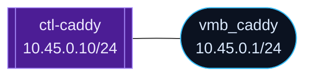

# 09_lxc-caddy

<!-- generado:inicio -->
_Datos derivados de `09_lxc-caddy.yml`. Los reescribe `./lab check docs --actualizar`;
si los editas a mano, `./lab check docs` falla._

## Topología

En el diagrama, la **forma** y el **color** de cada equipo dicen qué es (el tipo declarado):

- `ctl` — ctl (control del lab)

## Invitados declarados

| rol | tipo | plataforma | stage | cores | memory (MB) | disk (GB) | bridge | address |
| --- | --- | --- | --- | --- | --- | --- | --- | --- |
| caddy | ctl (control del lab) | LXC | 1 | 1 | 512 | 4 | vmb_caddy | 10.45.0.10/24 |

## Bridges del lab

| bridge | dirección del bridge |
| --- | --- |
| vmb_caddy | 10.45.0.1/24 |

## Orden de arranque (etapas)

| stage | roles |
| --- | --- |
| 1 | caddy |

## Identidad: la deriva el motor, no la declara el lab

| rol | tipo | nombre canónico | vmid | MAC |
| --- | --- | --- | --- | --- |
| caddy | ctl (control del lab) | ctl-caddy | — | — |

El **vmid** (el menor libre de *todo* el clúster) y la **MAC** (`BC:24:11` + los
bytes del vmid) los asigna `apply` leyendo el estado de Proxmox: no se declaran aquí y
no se guardan en ningún fichero del repositorio. Por eso estas dos columnas son un
guion hasta que exista un despliegue real.

## Cómo se entra a cada equipo

| rol | tipo | usuario | credencial | forma de acceso |
| --- | --- | --- | --- | --- |
| caddy | ctl (control del lab) | root | clave del lab (`~/.ssh/netlabs_tunnel_09_lxc-caddy_ed25519`), sin contraseña | SSH a `127.0.0.1`:(`20000`+vmid): él ES el bastión, se entra directo por su túnel |

El **usuario**, la **credencial** (de dónde sale Y cuánto vale) y la **forma de acceso** se
derivan de la declaración, del motor y de `deployment_engine/secrets.yml`. **Este lab es de un
solo uso y la contraseña se escribe aquí a la vista a propósito** (decisión explícita del dueño
del repo): es un cuadro de acceso, no un secreto — en un lab efímero prima poder entrar. El
puerto sale del **vmid**, que no se conoce hasta `apply`: por eso va como fórmula (`base`+vmid)
y el número de verdad lo dice el despliegue. Un invitado sin `config:` no se toca, y su fila lo
dice en vez de fingir un acceso que no hay. (En un Linux la credencial **no es una contraseña**:
es el **fichero** de la clave del lab, y por eso se enseña su ruta, no un valor.)
<!-- generado:fin -->

## Por qué así

Este lab existe para una sola cosa: **enseñar el YAML declarativo**. No hay nada que
enrutar, así que no hay router; no hay nada que filtrar, así que no hay cortafuegos.
Un contenedor, una red, una etapa. Todo lo que se ve aquí es lo que el motor necesita
para levantar un equipo y hablarle, y nada más.

**Por qué un LXC y no una VM.** El contenedor no tiene kernel propio, así que el motor
no espera a un arranque lento: es el caso más barato para mirar el ciclo entero
(`plan` → `apply` → `verify`) sin ruido alrededor.

**Por qué el contenedor ES el bastión.** En este lab no hay un equipo de control aparte
—no hay nada que controlar—, así que el propio contenedor hace de bastión: es lo que
hace que el motor le construya su túnel y pueda entrar a configurarlo. El nombre lo
dice (`ctl-caddy`, por su `tipo: ctl`) y es el motor quien lo deriva, no el lab.

**Por qué la salida se enciende por consola y no por SSH.** Un invitado recién creado
no tiene a nadie escuchando en el puerto 22 todavía: el motor le manda el arranque del
túnel por su consola (que en un LXC entrega la shell de root directamente, sin login) y
sólo entonces entra por SSH. La primera vez no hay otra vía, y por eso la consola es
una vía de acceso con mayúsculas y tiene su propio diario.

**El área `servicio`: qué se declara y qué no.** Este lab declara `servicio: caddy`, y con
eso el motor instala el paquete, escribe su Caddyfile y su página de relleno, deja la unidad
de systemd habilitada y en marcha, y lo comprueba **sirviéndola** (un `curl` a 127.0.0.1 desde
dentro, por la vía de acceso). El nombre del servicio es de un vocabulario **cerrado** cuya
única pieza es hoy `caddy` (ADR 0027): un nombre que no esté se **rechaza** al leer la
declaración —con su motivo, no se ignora—. El área gobierna el paquete, la unidad y la
configuración que escribe el motor; **no** borra paquetes ajenos, y si un lab no declara
`servicio`, no se toca nada (regla 17). El contrato es el de siempre: un invitado ya convergido
no produce ni una operación, y la relectura lo demuestra.

**Lo que este lab NO hace, y por qué.** No hay router ni segunda red: no hay nada que enrutar
ni que filtrar. La instalación del paquete sale a internet por la **pata de gestión** del
contenedor —la segunda interfaz que el motor le añade, en el bridge de gestión del nodo y con su
puerta de enlace (medido: `net1` con `gw`)—, **no** por el túnel: el túnel es una conexión que se
apoya en esa salida, no la salida. Por eso el lab no necesita router. Lo que tampoco
demuestra es un servicio detrás de un cortafuegos o en una red interna —para eso harían falta un
`rt` y un `fw`—, y este lab existe justo para ser el caso mínimo: un contenedor, una red, una
etapa y un servicio que se enciende solo.

**Un fallo que este lab destapó.** Al aplicarlo por primera vez, el motor creó **dos**
contenedores para el mismo rol (`114` y `115`): en el diario quedan tres intentos de
creación —el segundo choca con el `114` que el primero acababa de crear— y el segundo
`apply` ya no crea nada (`changed=0`). El motor es idempotente una vez convergido; el
duplicado salió del primer arranque. Está apuntado aquí porque un lab que enseña el
ciclo entero también enseña, cuando aparece, dónde falla.
