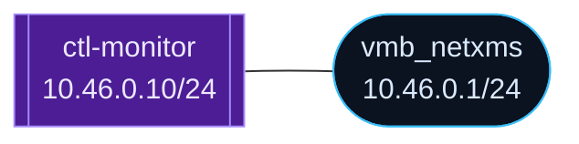

<!-- PROPÓSITO:   el documento del lab. Dos regiones, dos escritores.
     INVARIANTES: la región generada (entre los marcadores) la reescribe
                  `./lab check docs --actualizar`; `./lab check docs` falla si el
                  fichero difiere de su render. La prosa de fuera NO la toca
                  ningún check: escribe lo que el YAML no puede decir.
     LÍMITES:     la prosa no repite valores que ya están en la tabla; los cita.
     VER:         AGENTS.md §Documentación; README.md §Documentación;
                  docs/crear-un-lab.md (la guía de campo: las decisiones, en orden) -->

# 10_lxc-netxms

El lab mínimo otra vez, con el servicio más incómodo de los dos: un contenedor LXC que es
bastión y servidor a la vez, con **NetXMS** dentro. Donde el `09_lxc-caddy` demuestra que el
área `servicio` sabe instalar y servir un paquete, éste demuestra que sabe gobernar un
servicio que **no está completo al instalarlo**: NetXMS necesita un repositorio APT que no
está en Debian, una base de datos con su usuario, su esquema (que no crea el paquete) y una
aplicación web dentro de un contenedor de servlets. La declaración es la misma de siempre --
`servicio: netxms`, el nombre y nada más -- porque todo eso es vocabulario del motor
(ADR 0028).

<!-- generado:inicio -->
_Datos derivados de `10_lxc-netxms.yml`. Los reescribe `./lab check docs --actualizar`;
si los editas a mano, `./lab check docs` falla._

## Topología

En el diagrama, la **forma** y el **color** de cada equipo dicen qué es (el tipo declarado):

- `ctl` — ctl (control del lab)

## Invitados declarados

| rol | tipo | plataforma | stage | cores | memory (MB) | disk (GB) | bridge | address |
| --- | --- | --- | --- | --- | --- | --- | --- | --- |
| monitor | ctl (control del lab) | LXC | 1 | 2 | 1024 | 6 | vmb_netxms | 10.46.0.10/24 |

## Bridges del lab

| bridge | dirección del bridge |
| --- | --- |
| vmb_netxms | 10.46.0.1/24 |

## Orden de arranque (etapas)

| stage | roles |
| --- | --- |
| 1 | monitor |

## Identidad: la deriva el motor, no la declara el lab

| rol | tipo | nombre canónico | vmid | MAC |
| --- | --- | --- | --- | --- |
| monitor | ctl (control del lab) | ctl-monitor | — | — |

El **vmid** (el menor libre de *todo* el clúster) y la **MAC** (`BC:24:11` + los
bytes del vmid) los asigna `apply` leyendo el estado de Proxmox: no se declaran aquí y
no se guardan en ningún fichero del repositorio. Por eso estas dos columnas son un
guion hasta que exista un despliegue real.

## Cómo se entra a cada equipo

| rol | tipo | usuario | credencial | forma de acceso |
| --- | --- | --- | --- | --- |
| monitor | ctl (control del lab) | root | clave del lab (`~/.ssh/netlabs_tunnel_10_lxc-netxms_ed25519`), sin contraseña | SSH a `127.0.0.1`:(`20000`+vmid): él ES el bastión, se entra directo por su túnel |

El **usuario**, la **credencial** (de dónde sale Y cuánto vale) y la **forma de acceso** se
derivan de la declaración, del motor y de `deployment_engine/secrets.yml`. **Este lab es de un
solo uso y la contraseña se escribe aquí a la vista a propósito** (decisión explícita del dueño
del repo): es un cuadro de acceso, no un secreto — en un lab efímero prima poder entrar. El
puerto sale del **vmid**, que no se conoce hasta `apply`: por eso va como fórmula (`base`+vmid)
y el número de verdad lo dice el despliegue. Un invitado sin `config:` no se toca, y su fila lo
dice en vez de fingir un acceso que no hay. (En un Linux la credencial **no es una contraseña**:
es el **fichero** de la clave del lab, y por eso se enseña su ruta, no un valor.)
<!-- generado:fin -->

## Por qué así

Es el `09_lxc-caddy` con otro miembro del vocabulario, y esa es justo la lección: **el lab no
cambia de forma cuando cambia de servicio**. Un solo invitado, una sola red, una sola etapa y
ni un router: no hay topología que enrutar, así que no se enruta nada. Si el área `servicio`
tuviera la forma de `caddy` (dos ficheros y una unidad), este lab sería imposible sin una
primitiva nueva por producto; con la forma general del ADR 0028 cada servicio declara sus
piezas y el laboratorio sigue escribiendo una línea.

Lo que se quiere poder demostrar:

- que el motor **añade el repositorio APT ajeno** (`netxms-release`), y que lo hace **sólo si
  falta** -- la comprobación es `dpkg -s`, estado, no «ya lo intenté»;
- que **prepara la base antes de arrancar**: usuario, base y esquema, con `nxdbmgr init` sólo
  si la base no tiene tablas (lanzarlo sobre una base ya inicializada es un error);
- que la **web se comprueba sirviendo**: el `sirve` de este servicio es un `curl` a
  `127.0.0.1:8080/nxmc/`, no al puerto del servidor (4700), porque lo que el lab promete es
  que se puede **entrar**, no que el proceso esté vivo;
- que todo eso es **idempotente**: releído y al día, el invitado no deja ni un paso (regla 6).

## Qué se rompió (y cómo se arregló)

Cinco tropiezos, todos MEDIDOS en el ciclo real (el diario de cada uno está en `logs/`), y
ninguno se adivinó:

1. **El paquete de release dejó el repositorio a medias.** `netxms-release` trae la lista
   `/etc/apt/sources.list.d/netxms.list` con la plantilla `.../%s %s main` que rellena su
   `postinst` con `lsb_release`; si ese `postinst` no llega a correr (dependencia sin
   resolver), la lista se queda con `VENDOR DIST` dentro y **`apt-get update` falla entero**:
   no se instala NADA, ni siquiera lo que viene de Debian. Arreglo: el motor escribe la lista
   él mismo, leyendo distribuidor y versión de `/etc/os-release` del propio invitado.
2. **El servidor no lee `/etc/netxmsd.conf` por su cuenta.** La unidad de Debian arranca
   `netxmsd -S` a secas y el binario se fue a una **base SQLite local**, con el laboratorio a
   punto de darse por convergido contra la base equivocada. Arreglo: un `drop-in` de systemd
   que vacía `ExecStart` y lo redefine con `-c /etc/netxmsd.conf` (vaciar no es estético:
   systemd acumula líneas y el servidor habría arrancado dos veces).
3. **`nxdbmgr init` no deduce el motor.** Sin `-c` no encuentra la configuración; con `-c` y
   sin tipo contesta «Cannot determine database type from driver name». Arreglo: `nxdbmgr -c
   /etc/netxmsd.conf init pgsql`.
4. **El paquete arrastra un agente que se queda con el 4700** (`netxms-agent`, dependencia de
   `netxms-server`). Este lab no monitoriza nada. Arreglo: el preparador lo deshabilita.
5. **La web contesta 302 y el cuerpo llega vacío.** El `sirve` original (`curl -fsS`) leía
   «no sirve» para siempre con la web perfectamente en pie. Arreglo: `-L` (seguir la
   redirección a `nxmc-light.app`) y exigir cuerpo.

Y un sexto, de diseño, que se vio al mirar el primero: **el `extra` de NetXMS no podía mirar
sólo la base**. Con el esquema ya inicializado y el WAR sin descargar, la preparación no se
volvía a pedir nunca y la web no servía jamás: ahora `estado` exige esquema **y** WAR.

## Qué está verificado, y qué no

Verificado (con la salida en `logs/`):

- el **ciclo entero** `destroy → apply → verify` en el Proxmox real, con
  `VERIFICACIÓN del lab '10_lxc-netxms' — CORRECTO` y el interior `1/1 invitado(s) leído(s)
  por dentro y coincidente(s)`;
- la **web sirviendo**: `curl -fsSL http://127.0.0.1:8080/nxmc/` → `código=200 bytes=3236
  url=http://127.0.0.1:8080/nxmc/nxmc-light.app` (la aplicación ligera del cliente web);
- la **base con su esquema**: 216 tablas en el esquema `public` de la base `netxms`;
- **las tres unidades** (`netxms-server`, `tomcat10`, `postgresql`) `active` y `enabled`, el
  servidor escuchando en el 4701 (clientes) y Tomcat en el 8080, y `netxms-agent`
  **deshabilitado** (no lo pide nadie);
- la **segunda pasada** en `changed=0`, con `logs/api.jsonl` de esa pasada en **40 llamadas,
  las 40 GET**, y el interior en **3 lecturas y ninguna escritura**.

Lo que NO se puede afirmar todavía:

- **nadie monitoriza a nadie**: el árbol de nodos del servidor queda vacío. Este lab mide el
  servicio, no el producto (para eso haría falta un agente, y ése sería otro miembro del
  vocabulario, con su ADR);
- la web se comprueba por **su página de entrada**, no por un login con credenciales: el
  laboratorio no escribe contraseñas de la web en ningún sitio;
- **sin persistencia entre pasadas de la base**: `destroy` se lleva el contenedor y con él
  PostgreSQL. El lab no demuestra copias de seguridad ni migraciones de esquema.

## Qué queda fuera

- **La versión del WAR está pinchada en el motor** (`7.0.3`, la del servidor del repositorio).
  Si el repositorio de NetXMS publica otra 7.0.x, el WAR se queda atrás: alinear las dos
  versiones es trabajo del motor (y hoy no hay comprobación de que coincidan).
- **Tomcat 10 viene de Debian** y no se configura: el WAR se deja en `webapps/` y se confía en
  el autodespliegue. Un `autoDeploy` apagado, o un `tomcat10` que no arranque, se ve como «no
  sirve» y el motor recarga -- no lo distingue de una web rota.
- **La contraseña de la base es del motor y está en claro en `/etc/netxmsd.conf`** (y en el
  repositorio, en el contenido del preparador). Es un lab sandbox; en un entorno de verdad,
  esto sería un secreto y no vocabulario.
- **El árbol de nodos, el correo de alarmas y las políticas de NetXMS** son configuración
  funcional del producto: el área `servicio` no la gobierna (no es del motor ni del lab).