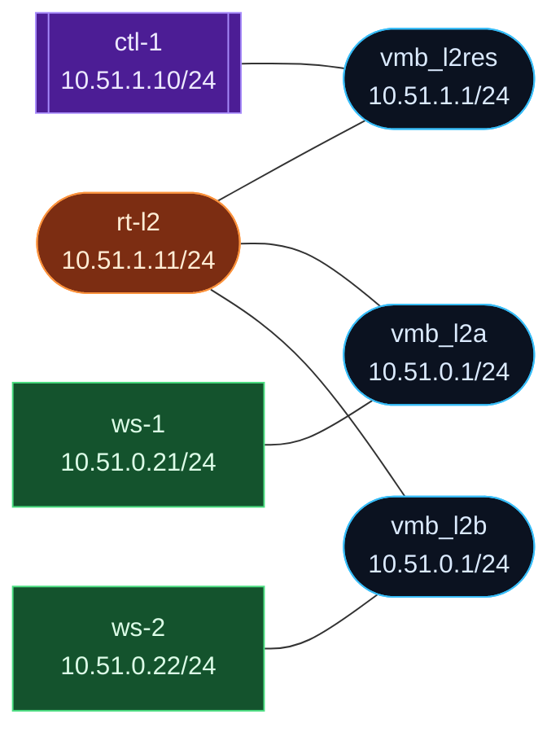

<!-- PROPÓSITO:   el documento del lab. Dos regiones, dos escritores.
     INVARIANTES: la región generada (entre los marcadores) la reescribe
                  `./lab check docs --actualizar`; `./lab check docs` falla si el
                  fichero difiere de su render. La prosa de fuera NO la toca
                  ningún check: escribe lo que el YAML no puede decir.
     LÍMITES:     la prosa no repite valores que ya están en la tabla; los cita.
     VER:         AGENTS.md §Documentación; README.md §Documentación;
                  docs/crear-un-lab.md (la guía de campo: las decisiones, en orden) -->

# 11_l2-research

Plantilla de documento. Sustituye este párrafo por qué topología es ésta, para qué
sirve y qué la hace distinta.

<!-- generado:inicio -->
_Datos derivados de `11_l2-research.yml`. Los reescribe `./lab check docs --actualizar`;
si los editas a mano, `./lab check docs` falla._

## Topología

En el diagrama, la **forma** y el **color** de cada equipo dicen qué es (el tipo declarado):

- `rt` — rt (enruta y sale)
- `ws` — ws (puesto de trabajo)
- `ctl` — ctl (control del lab)

## Invitados declarados

| rol | tipo | plataforma | stage | cores | memory (MB) | disk (GB) | bridge | address |
| --- | --- | --- | --- | --- | --- | --- | --- | --- |
| conmutador | rt (enruta y sale) | VM (qemu) | 1 | 1 | 512 | 1 | vmb_l2res + vmb_l2a + vmb_l2b | 10.51.1.11/24 |
| extremo-a | ws (puesto de trabajo) | LXC | 1 | 1 | 256 | 4 | vmb_l2a | 10.51.0.21/24 |
| extremo-b | ws (puesto de trabajo) | LXC | 1 | 1 | 256 | 4 | vmb_l2b | 10.51.0.22/24 |
| monitor | ctl (control del lab) | LXC | 1 | 2 | 1024 | 6 | vmb_l2res | 10.51.1.10/24 |

## Bridges del lab

| bridge | dirección del bridge |
| --- | --- |
| vmb_l2res | 10.51.1.1/24 |
| vmb_l2a | 10.51.0.1/24 |
| vmb_l2b | 10.51.0.1/24 |

## Orden de arranque (etapas)

| stage | roles |
| --- | --- |
| 1 | conmutador, extremo-a, extremo-b, monitor |

## Identidad: la deriva el motor, no la declara el lab

| rol | tipo | nombre canónico | vmid | MAC |
| --- | --- | --- | --- | --- |
| conmutador | rt (enruta y sale) | rt-l2 | — | — |
| extremo-a | ws (puesto de trabajo) | ws-1 | — | — |
| extremo-b | ws (puesto de trabajo) | ws-2 | — | — |
| monitor | ctl (control del lab) | ctl-1 | — | — |

El **vmid** (el menor libre de *todo* el clúster) y la **MAC** (`BC:24:11` + los
bytes del vmid) los asigna `apply` leyendo el estado de Proxmox: no se declaran aquí y
no se guardan en ningún fichero del repositorio. Por eso estas dos columnas son un
guion hasta que exista un despliegue real.

## Cómo se entra a cada equipo

| rol | tipo | usuario | credencial | forma de acceso |
| --- | --- | --- | --- | --- |
| conmutador | rt (enruta y sale) | admin | `admin` / la de `secrets.yml` → `routeros_clave` (HTTP Basic) | REST por el túnel del bastión (`21000`+vmid); su consola, por la serial del nodo |
| extremo-a | ws (puesto de trabajo) | — | — | no se entra: no declara `config:` |
| extremo-b | ws (puesto de trabajo) | — | — | no se entra: no declara `config:` |
| monitor | ctl (control del lab) | root | clave del lab (`~/.ssh/netlabs_tunnel_11_l2-research_ed25519`), sin contraseña | SSH a `127.0.0.1`:(`20000`+vmid): él ES el bastión, se entra directo por su túnel |

El **usuario**, la **credencial** (de dónde sale Y cuánto vale) y la **forma de acceso** se
derivan de la declaración, del motor y de `deployment_engine/secrets.yml`. **Este lab es de un
solo uso y la contraseña se escribe aquí a la vista a propósito** (decisión explícita del dueño
del repo): es un cuadro de acceso, no un secreto — en un lab efímero prima poder entrar. El
puerto sale del **vmid**, que no se conoce hasta `apply`: por eso va como fórmula (`base`+vmid)
y el número de verdad lo dice el despliegue. Un invitado sin `config:` no se toca, y su fila lo
dice en vez de fingir un acceso que no hay. (En un Linux la credencial **no es una contraseña**:
es el **fichero** de la clave del lab, y por eso se enseña su ruta, no un valor.)
<!-- generado:fin -->

## Por qué así

Qué topología es y por qué ésta y no otra: qué se quiere poder demostrar con ella.

## Qué se rompió (y cómo se arregló)

Lo que falló al desplegarla de verdad, y qué se hizo. Es lo que más vale del
documento: nadie más va a tropezar donde tú tropezaste (*filing back*).

## Qué está verificado, y qué no

Qué se comprobó y con qué salida; y qué no se puede comprobar todavía, dicho en
claro en vez de maquillado.

## Qué queda fuera

Los límites, y lo que este lab NO decide (porque es de otro lab, del motor o del
entorno).
